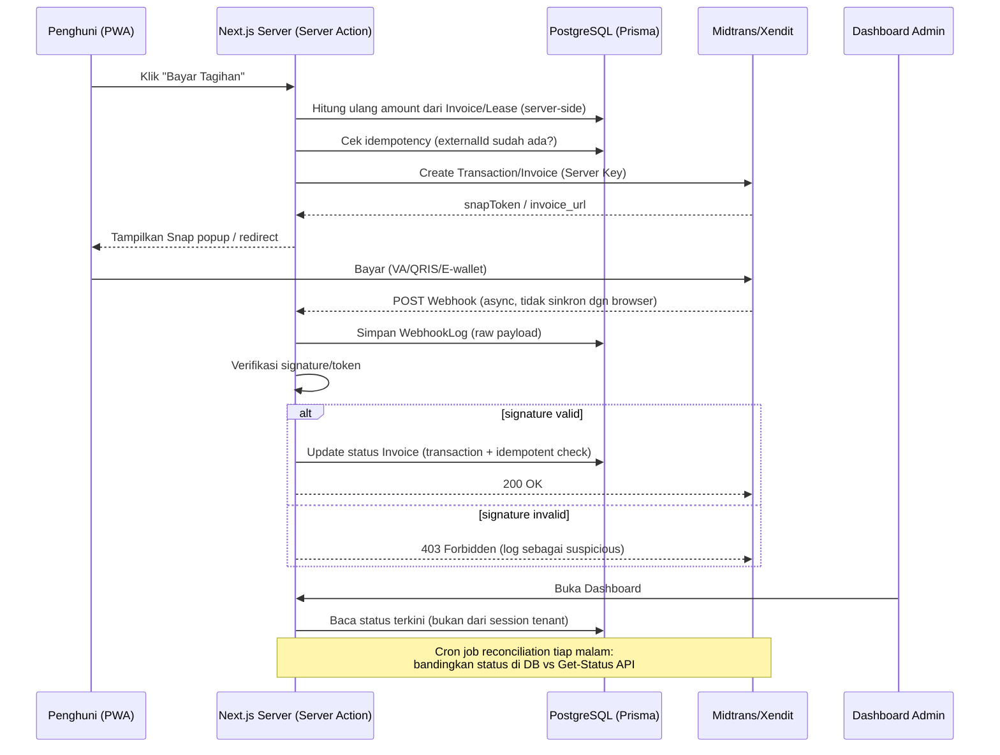

# Panduan Implementasi Payment Gateway - OsKost

> Dokumen pendamping dari `Project_Architecture_Blueprint.md` dan `Dokumentasi_Bisnis_Project_Oskost.md`. Fokus: integrasi Midtrans/Xendit dengan standar keamanan & keandalan enterprise level, disesuaikan dengan stack Next.js 16 (App Router) + Prisma v7 + PostgreSQL + Supabase yang sudah ditentukan.

---

## 1. Prinsip Dasar yang Wajib Dipegang

Sebelum masuk ke kode, ini adalah 5 prinsip yang membedakan implementasi "asal jalan" dengan implementasi enterprise level. Hampir semua bug/celah keamanan payment gateway berakar dari pelanggaran salah satu prinsip ini:

1. **Server adalah satu-satunya sumber kebenaran (source of truth).** Status pembayaran TIDAK PERNAH ditentukan oleh browser/client (misalnya redirect `?status=success` dari URL). Status hanya boleh berubah lewat webhook yang tervalidasi atau hasil query langsung ke API gateway.
2. **Semua proses harus idempotent.** Baik user meng-klik tombol bayar 5x, maupun gateway mengirim webhook yang sama 2x (ini *memang* bisa terjadi dan didokumentasikan resmi oleh Midtrans & Xendit), sistem tidak boleh membuat data ganda atau memproses pembayaran dua kali.
3. **Jangan pernah percaya angka dari client.** Total tagihan (`gross_amount`/`amount`) selalu dihitung ulang di server dari data `Lease`/`Invoice` di database, bukan dari nilai yang dikirim form.
4. **Secret key tidak boleh menyentuh client.** `MIDTRANS_SERVER_KEY` dan `XENDIT_SECRET_KEY` hanya boleh dipakai di `server-only` code — sesuai pola yang sudah kalian pakai di `room-service.ts`.
5. **Setiap notifikasi yang masuk harus dicatat (audit log) sebelum diproses**, supaya kalau terjadi sengketa ("saya sudah transfer tapi status masih pending") kalian punya bukti forensik.

---

## 2. Midtrans vs Xendit — Perbandingan untuk Kasus OsKost

| Aspek | Midtrans | Xendit |
|---|---|---|
| Model integrasi utama | **Snap** (popup/embedded di halaman sendiri, tidak perlu redirect keluar) | **Invoice API** (biasanya redirect ke halaman hosted Xendit) atau Payment Session untuk embedded |
| Verifikasi webhook | `SHA512(order_id + status_code + gross_amount + ServerKey)` dibandingkan dengan field `signature_key` di body | Header `x-callback-token` dibandingkan string-compare dengan Verification Token di dashboard |
| Kompleksitas verifikasi | Sedikit lebih rumit (hash), tapi lebih "self-contained" | Lebih sederhana (string compare), tapi wajib disimpan sebagai secret |
| IP Allowlist | Tidak terlalu ditekankan | Tersedia dan direkomendasikan resmi sebagai lapisan tambahan |
| Metode pembayaran lokal | VA (BCA/BNI/BRI/Permata), GoPay, QRIS, kartu kredit, retail (Alfamart/Indomaret) | Sama lengkapnya, plus fitur **Disbursement** (kirim dana keluar) jika suatu saat butuh bayar vendor/kontraktor |
| Cocok untuk kasus kost | Sangat cocok — arus uang cuma satu arah (tenant → owner) | Sama cocoknya; kelebihannya baru terasa kalau nanti ada kebutuhan payout ke pihak ketiga |

**Rekomendasi untuk OsKost:** karena model bisnisnya sederhana (tenant bayar sewa → masuk ke satu rekening owner, tidak ada payout ke banyak pihak), **kedua provider sama-sama cocok**. Jangan terlalu lama memilih — pilih satu, implementasikan dengan benar mengikuti panduan di bawah, dan arsitektur `payment-service.ts` di bawah ini sengaja dibuat **provider-agnostic** (pakai kolom `provider` di skema) supaya nanti gampang menambah provider kedua tanpa refactor besar.

---

## 3. Alur Sistem (High-Level)



Poin krusial: **konfirmasi ke tenant di browser TIDAK BOLEH jadi penentu status lunas.** Browser hanya menampilkan "Menunggu konfirmasi..." lalu polling status ke server, sedangkan yang benar-benar mengubah status adalah webhook di atas.

---

## 4. Skema Database (Prisma)

Menambahkan pada `prisma/schema.prisma` yang sudah ada (`Invoice` sudah disebut di blueprint kalian, ini versi lengkapnya):

```prisma
enum PaymentProvider {
  MIDTRANS
  XENDIT
}

enum InvoiceStatus {
  PENDING
  PAID
  EXPIRED
  FAILED
  CANCELLED
  REFUNDED
}

model Invoice {
  id          String          @id @default(cuid())
  externalId  String          @unique // order_id (Midtrans) / external_id (Xendit) -> KUNCI idempotency
  leaseId     String
  lease       Lease           @relation(fields: [leaseId], references: [id])

  // Simpan sebagai Integer (rupiah bulat), JANGAN pakai Float — floating point
  // bisa menyebabkan selisih 1 rupiah yang bikin validasi gateway gagal.
  amount      Int

  status      InvoiceStatus   @default(PENDING)
  provider    PaymentProvider
  providerRef String?         // transaction_id (Midtrans) / invoice id (Xendit)
  paymentUrl  String?         // redirect_url / invoice_url
  snapToken   String?         // khusus Midtrans Snap

  paidAt      DateTime?
  expiredAt   DateTime?
  createdAt   DateTime        @default(now())
  updatedAt   DateTime        @updatedAt

  webhookLogs WebhookLog[]

  @@index([status])
  @@index([leaseId])
}

// Audit trail WAJIB ada — bukti forensik saat ada sengketa/investigasi fraud
model WebhookLog {
  id             String          @id @default(cuid())
  invoiceId      String?
  invoice        Invoice?        @relation(fields: [invoiceId], references: [id])
  provider       PaymentProvider
  rawPayload     Json
  signatureValid Boolean         @default(false)
  httpStatusSent Int?
  createdAt      DateTime        @default(now())

  @@index([provider, createdAt])
}
```

**Kenapa `externalId` harus `@unique`?** Ini adalah lapisan pertahanan idempotency di level database. Kalau ada dua request "create transaction" yang lolos dari pengecekan aplikasi (misalnya karena race condition/double click super cepat), database akan menolak insert kedua dengan constraint error — jadi tidak ada dua invoice untuk tagihan yang sama.

---

## 5. Struktur Folder (Mengikuti FSD yang Sudah Ditetapkan)

```
src/features/payment/
├── payment-service.ts          # server-only, akses Prisma + panggil API gateway
├── payment-schema.ts           # Zod schemas untuk input & webhook payload
├── payment-status.ts           # state machine transisi status yang valid
├── components/
│   ├── pay-button.tsx          # client component, trigger server action
│   └── invoice-status-badge.tsx
└── index.ts
```

Webhook **tidak** masuk ke `src/features/payment` sebagai Server Action, melainkan sebagai **Route Handler** di `src/app/api/webhooks/`, karena harus bisa diakses langsung via HTTP POST oleh server Midtrans/Xendit dari luar (Server Action tidak bisa dipanggil begitu saja oleh pihak eksternal).

```
src/app/api/webhooks/
├── midtrans/route.ts
└── xendit/route.ts
```

---

## 6. Implementasi Kode

### 6.1 Environment Variables

```bash
# .env (JANGAN commit ke git — masukkan ke .gitignore & secret manager Vercel/hosting)
MIDTRANS_SERVER_KEY=SB-Mid-server-xxxxxxxxxxxxxxxx
MIDTRANS_IS_PRODUCTION=false
NEXT_PUBLIC_MIDTRANS_CLIENT_KEY=SB-Mid-client-xxxxxxxxxxxxxxxx   # ini memang boleh publik

XENDIT_SECRET_KEY=xnd_development_xxxxxxxxxxxxxxxx
XENDIT_WEBHOOK_TOKEN=xxxxxxxxxxxxxxxx   # dari Dashboard > Webhook Settings
```

Aturan: **hanya field berawalan `NEXT_PUBLIC_` yang boleh berisi client key**. Kalau ada engineer baru yang tidak sengaja menaruh `SERVER_KEY` dengan prefix `NEXT_PUBLIC_`, itu adalah kebocoran fatal — kunci server bisa dipakai siapa saja untuk membuat transaksi atau menarik data dari akun gateway kalian. Tambahkan ESLint rule / code review checklist khusus untuk ini.

### 6.2 Zod Schema

```typescript
// src/features/payment/payment-schema.ts
import { z } from "zod";

export const createPaymentSchema = z.object({
  leaseId: z.string().cuid(),
});

export const midtransNotificationSchema = z.object({
  order_id: z.string(),
  status_code: z.string(),
  gross_amount: z.string(),
  signature_key: z.string(),
  transaction_status: z.string(),
  fraud_status: z.string().optional(),
  transaction_id: z.string(),
});

export const xenditCallbackSchema = z.object({
  external_id: z.string(),
  id: z.string(),
  status: z.string(),
  paid_amount: z.number().optional(),
});
```

Semua payload webhook **wajib divalidasi Zod sebelum dipakai** — ini mencegah bug turunan kalau suatu saat provider menambah/mengubah field, atau kalau ada payload cacat yang dikirim (sengaja/tidak) ke endpoint kalian.

### 6.3 Service Layer — Create Transaction (Midtrans, contoh)

```typescript
// src/features/payment/payment-service.ts
import "server-only";
import { prisma } from "@/lib/db";
import { createPaymentSchema } from "./payment-schema";
import { z } from "zod";

export async function createMidtransTransaction(
  input: z.infer<typeof createPaymentSchema>,
) {
  const { leaseId } = createPaymentSchema.parse(input);

  const lease = await prisma.lease.findUniqueOrThrow({
    where: { id: leaseId },
    include: { tenantProfile: true, user: true },
  });

  // Amount DIHITUNG ULANG dari data server, bukan dari input client.
  const amount = lease.monthlyRent; // contoh — sesuaikan dgn field aslimu
  const billingPeriod = getCurrentBillingPeriod(); // e.g. "2026-07"
  const externalId = `INV-${leaseId}-${billingPeriod}`; // deterministik, bukan random

  // Idempotency check di level aplikasi (selain constraint DB)
  const existing = await prisma.invoice.findUnique({ where: { externalId } });
  if (existing?.status === "PAID") {
    throw new Error("Tagihan periode ini sudah lunas.");
  }
  if (existing?.status === "PENDING" && existing.snapToken) {
    return existing; // Kembalikan transaksi yang sama, jangan bikin baru
  }

  const res = await fetch(
    `https://app.${process.env.MIDTRANS_IS_PRODUCTION === "true" ? "" : "sandbox."}midtrans.com/snap/v1/transactions`,
    {
      method: "POST",
      headers: {
        "Content-Type": "application/json",
        Authorization: `Basic ${Buffer.from(process.env.MIDTRANS_SERVER_KEY + ":").toString("base64")}`,
      },
      body: JSON.stringify({
        transaction_details: { order_id: externalId, gross_amount: amount },
        customer_details: {
          first_name: lease.user.name,
          email: lease.user.email,
        },
      }),
    },
  );

  if (!res.ok) {
    const errBody = await res.text();
    throw new Error(`Midtrans API error (${res.status}): ${errBody}`);
  }

  const { token, redirect_url } = await res.json();

  return prisma.invoice.upsert({
    where: { externalId },
    create: {
      externalId,
      leaseId,
      amount,
      provider: "MIDTRANS",
      snapToken: token,
      paymentUrl: redirect_url,
      status: "PENDING",
    },
    update: { snapToken: token, paymentUrl: redirect_url },
  });
}
```

Catatan desain penting:
- `externalId` **deterministik** (`leaseId + periode`), bukan random/UUID. Ini yang membuat retry oleh user (klik ulang tombol bayar) otomatis idempotent — bukan mengandalkan disable-button di frontend saja (frontend bisa dibypass).
- `upsert` dipakai supaya request kedua untuk periode yang sama tidak gagal karena unique constraint, tapi juga tidak membuat baris baru.

### 6.4 Webhook Handler — Midtrans

```typescript
// src/app/api/webhooks/midtrans/route.ts
import { NextRequest, NextResponse } from "next/server";
import crypto from "crypto";
import { prisma } from "@/lib/db";
import { midtransNotificationSchema } from "@/features/payment/payment-schema";

export async function POST(req: NextRequest) {
  const rawBody = await req.json();

  // 1. Log SEBELUM diproses — kalau ada crash di tengah, tetap ada jejaknya
  const log = await prisma.webhookLog.create({
    data: { provider: "MIDTRANS", rawPayload: rawBody, signatureValid: false },
  });

  const parsed = midtransNotificationSchema.safeParse(rawBody);
  if (!parsed.success) {
    return NextResponse.json({ message: "Invalid payload" }, { status: 400 });
  }
  const payload = parsed.data;

  // 2. Verifikasi signature — SHA512(order_id + status_code + gross_amount + ServerKey)
  const expectedSignature = crypto
    .createHash("sha512")
    .update(
      payload.order_id +
        payload.status_code +
        payload.gross_amount +
        process.env.MIDTRANS_SERVER_KEY,
    )
    .digest("hex");

  if (expectedSignature !== payload.signature_key) {
    await prisma.webhookLog.update({
      where: { id: log.id },
      data: { httpStatusSent: 403 },
    });
    return NextResponse.json({ message: "Invalid signature" }, { status: 403 });
  }

  await prisma.webhookLog.update({
    where: { id: log.id },
    data: { signatureValid: true },
  });

  // 3. Update status secara idempotent di dalam transaction
  await prisma.$transaction(async (tx) => {
    const invoice = await tx.invoice.findUnique({
      where: { externalId: payload.order_id },
    });
    if (!invoice) return; // order_id tak dikenal — jangan crash, cukup ter-log
    if (invoice.status === "PAID") return; // sudah pernah diproses, stop di sini

    const nextStatus = mapMidtransStatus(
      payload.transaction_status,
      payload.fraud_status,
    );

    await tx.invoice.update({
      where: { id: invoice.id },
      data: {
        status: nextStatus,
        providerRef: payload.transaction_id,
        paidAt: nextStatus === "PAID" ? new Date() : undefined,
      },
    });

    await tx.webhookLog.update({
      where: { id: log.id },
      data: { invoiceId: invoice.id },
    });
  });

  // 4. Selalu balas cepat. Jangan kirim email/notifikasi berat secara sinkron di sini —
  //    kalau perlu, trigger job terpisah (queue/cron) agar response tidak lambat/timeout.
  return NextResponse.json({ message: "OK" }, { status: 200 });
}

function mapMidtransStatus(transactionStatus: string, fraudStatus?: string) {
  switch (transactionStatus) {
    case "capture":
      return fraudStatus === "challenge" ? "PENDING" : "PAID";
    case "settlement":
      return "PAID";
    case "pending":
      return "PENDING";
    case "deny":
    case "cancel":
      return "FAILED";
    case "expire":
      return "EXPIRED";
    default:
      return "PENDING";
  }
}
```

### 6.5 Webhook Handler — Xendit

```typescript
// src/app/api/webhooks/xendit/route.ts
import { NextRequest, NextResponse } from "next/server";
import { prisma } from "@/lib/db";
import { xenditCallbackSchema } from "@/features/payment/payment-schema";

export async function POST(req: NextRequest) {
  const callbackToken = req.headers.get("x-callback-token");
  const rawBody = await req.json();

  const log = await prisma.webhookLog.create({
    data: { provider: "XENDIT", rawPayload: rawBody, signatureValid: false },
  });

  // Verifikasi token DULU sebelum parsing/pemrosesan apa pun
  if (callbackToken !== process.env.XENDIT_WEBHOOK_TOKEN) {
    await prisma.webhookLog.update({
      where: { id: log.id },
      data: { httpStatusSent: 401 },
    });
    return NextResponse.json({ message: "Invalid token" }, { status: 401 });
  }

  await prisma.webhookLog.update({
    where: { id: log.id },
    data: { signatureValid: true },
  });

  const parsed = xenditCallbackSchema.safeParse(rawBody);
  if (!parsed.success) {
    return NextResponse.json({ message: "Invalid payload" }, { status: 400 });
  }
  const payload = parsed.data;

  await prisma.$transaction(async (tx) => {
    const invoice = await tx.invoice.findUnique({
      where: { externalId: payload.external_id },
    });
    if (!invoice || invoice.status === "PAID") return;

    const nextStatus =
      payload.status === "PAID"
        ? "PAID"
        : payload.status === "EXPIRED"
          ? "EXPIRED"
          : "PENDING";

    await tx.invoice.update({
      where: { id: invoice.id },
      data: {
        status: nextStatus,
        providerRef: payload.id,
        paidAt: nextStatus === "PAID" ? new Date() : undefined,
      },
    });
  });

  return NextResponse.json({ message: "OK" }, { status: 200 });
}
```

> **Catatan resmi dari Xendit** yang penting: mereka menyarankan agar pemrosesan berat dipisah dari acknowledgment webhook, karena kalau handler kalian lambat/timeout, event bisa dianggap gagal dan otomatis di-retry oleh Xendit selama 24 jam ke depan. Karena itu pola "log dulu → verifikasi → update DB (cepat) → balas 200" di atas sengaja disusun seminimal mungkin di jalur sinkron.

---

## 7. Pencegahan Bug & Human Error

| Risiko | Mitigasi |
|---|---|
| Invoice ganda untuk tagihan yang sama | `externalId` deterministik + `@unique` constraint + `upsert` |
| Race condition (webhook datang 2x bersamaan) | `prisma.$transaction` + cek `status === "PAID"` sebelum update (bukan cuma disable tombol di frontend) |
| Floating point error pada nominal uang | Simpan `amount` sebagai `Int` (rupiah bulat), jangan `Float`/`Decimal` yang longgar |
| Admin lupa cek status manual | Dashboard membaca status dari DB (hasil webhook), bukan dari state lokal — jadi selalu real-time tanpa perlu refresh manual admin |
| Invoice "menggantung" di status PENDING selamanya (VA/QRIS yang tidak dibayar & expired tanpa notifikasi) | Cron job harian yang expire invoice `PENDING` yang sudah lewat `expiredAt` |
| Perbedaan data antara gateway & database (misalnya webhook gagal terkirim karena server down saat maintenance) | **Reconciliation job** — lihat bagian 9 |
| Developer baru tidak sadar ada dua environment (sandbox vs production) dan salah pasang key | Pisahkan `.env.sandbox` / `.env.production` secara eksplisit + validasi startup yang menolak boot jika `MIDTRANS_IS_PRODUCTION=true` tapi key masih berawalan `SB-` |

---

## 8. Pencegahan Serangan (Security Checklist)

Ini adalah bagian yang paling sering diremehkan tim kecil tapi paling fatal kalau diabaikan.

- [ ] **Verifikasi signature/token WAJIB dan tidak bisa dilewati** — baik `signature_key` (Midtrans) maupun `x-callback-token` (Xendit) harus dicek di setiap request sebelum data diproses. Response 403/401 kalau gagal.
- [ ] **Jangan pernah mempercayai `gross_amount`/`amount` dari client saat *membuat* transaksi.** Selalu hitung ulang dari `Lease`/`Invoice` di database di sisi server.
- [ ] **Server Key/Secret Key hanya dipakai di kode `server-only`.** Tidak pernah dikirim ke client, tidak pernah muncul di response API publik, tidak pernah di-log.
- [ ] **Endpoint webhook publik secara desain** (memang harus bisa diakses gateway dari internet), tapi keamanannya bertumpu 100% pada verifikasi signature — bukan pada "menyembunyikan URL". Untuk Xendit, tambahkan **IP Allowlist** di dashboard sebagai lapisan tambahan (fitur resmi mereka).
- [ ] **Cegah IDOR**: saat tenant melihat detail invoice di PWA, pastikan ada authorization check bahwa `invoice.lease.userId === session.user.id` — jangan hanya mengandalkan ID yang "susah ditebak".
- [ ] **Rate limit endpoint pembuatan transaksi** (server action `createMidtransTransaction`/`createXenditInvoice`) — mencegah spam yang membuat quota API gateway kalian habis atau memicu biaya tak terduga.
- [ ] **Jangan pernah menyimpan nomor kartu/CVV.** Karena kalian pakai Snap (hosted popup) / Invoice (hosted page), data kartu tidak pernah menyentuh server kalian sama sekali — ini otomatis mengecilkan scope kepatuhan PCI-DSS kalian ke level paling ringan (SAQ A). Jangan rusak keuntungan ini dengan membuat form kartu custom sendiri.
- [ ] **Masking data sensitif di log.** `WebhookLog.rawPayload` boleh disimpan lengkap (untuk forensik), tapi pastikan tidak ada proses lain yang mencetak data ini ke console/log pihak ketiga tanpa masking (misalnya `masked_card` sudah otomatis termask dari Midtrans — jangan simpan versi unmasked di tempat lain).
- [ ] **HTTPS wajib, tanpa self-signed certificate** — ini persyaratan eksplisit dari kedua provider; notifikasi tidak akan terkirim/divalidasi kalau sertifikat tidak valid.
- [ ] **Secret tidak boleh masuk git.** Tambahkan `.env*` ke `.gitignore`, gunakan secret manager platform hosting (Vercel Environment Variables, dsb), dan rotate key kalau pernah ter-commit tidak sengaja.
- [ ] **Least privilege API key** — jika provider mendukung scoped API key (Xendit mendukung permission per key), buat key terpisah untuk keperluan create-invoice saja tanpa akses disbursement/balance, supaya kalau key ini bocor, dampaknya terbatas.

---

## 9. Reconciliation Job (Jaring Pengaman Terakhir)

Webhook **tidak 100% reliable** — bisa gagal terkirim karena server kalian sedang deploy, maintenance database (ingat NFR "read-only mode saat maintenance" di BRD kalian), atau masalah jaringan sesaat. Karena itu enterprise-level system selalu punya jaring pengaman kedua: job terjadwal yang membandingkan status di database dengan status asli di gateway.

```typescript
// src/app/api/cron/reconcile-invoices/route.ts
// Dijalankan tiap malam via Vercel Cron / scheduled job

import { prisma } from "@/lib/db";
import { NextResponse } from "next/server";

export async function GET() {
  const pendingInvoices = await prisma.invoice.findMany({
    where: { status: "PENDING", provider: "MIDTRANS" },
  });

  for (const invoice of pendingInvoices) {
    const res = await fetch(
      `https://api.sandbox.midtrans.com/v2/${invoice.externalId}/status`,
      {
        headers: {
          Authorization: `Basic ${Buffer.from(process.env.MIDTRANS_SERVER_KEY + ":").toString("base64")}`,
        },
      },
    );
    if (!res.ok) continue;
    const data = await res.json();

    if (data.transaction_status === "settlement" && invoice.status !== "PAID") {
      await prisma.invoice.update({
        where: { id: invoice.id },
        data: { status: "PAID", paidAt: new Date(), providerRef: data.transaction_id },
      });
      // Ini kasus penting: berarti webhook GAGAL terkirim sebelumnya.
      // Pertimbangkan kirim alert (Slack/email) supaya tim tahu ada gap.
    }
  }

  return NextResponse.json({ checked: pendingInvoices.length });
}
```

Terapkan pola yang sama untuk Xendit menggunakan endpoint Get Invoice.

---

## 10. Testing Checklist Sebelum Go-Live

- [ ] Test end-to-end di **sandbox/test mode** — jangan pernah lompat langsung ke production tanpa simulasi.
- [ ] Gunakan **ngrok** (atau tunnel sejenis) untuk expose `localhost` supaya webhook sandbox benar-benar bisa terkirim ke mesin development kalian.
- [ ] Simulasikan notifikasi via fitur bawaan dashboard Midtrans (Settings > Configuration > See History) untuk memastikan handler kalian benar-benar bisa memproses payload asli, bukan payload buatan sendiri yang mungkin format-nya beda.
- [ ] Test skenario **signature tidak valid** (kirim payload dengan signature salah) — pastikan sistem menolak dengan 403, bukan malah memproses.
- [ ] Test skenario **webhook duplikat** — kirim payload sukses yang sama 2x, pastikan status tidak berubah dua kali / tidak ada efek samping ganda.
- [ ] Test skenario **race condition** — trigger dua request create-transaction bersamaan untuk lease yang sama, pastikan hanya satu invoice yang terbentuk.
- [ ] Test flow **expired** (VA/QRIS yang tidak dibayar sampai lewat waktu).
- [ ] Review manual: pastikan tidak ada `console.log` yang mencetak Server Key/Secret Key di mana pun (termasuk error log).

---

## 11. Go-Live Checklist

- [ ] Ganti seluruh key sandbox → production, dan **jangan campur** environment di file `.env` yang sama.
- [ ] Update Notification/Webhook URL di dashboard provider ke domain production (bukan ngrok/staging).
- [ ] Aktifkan IP Allowlist (Xendit) jika tersedia untuk plan kalian.
- [ ] Pastikan sertifikat HTTPS domain production valid (bukan self-signed) dan endpoint webhook bisa diakses publik tanpa autentikasi tambahan (auth header/basic auth) — karena Midtrans secara eksplisit tidak bisa mengirim notifikasi ke endpoint yang butuh autentikasi.
- [ ] Setup monitoring/alert (Slack/email) untuk kegagalan webhook — baik dari sisi kalian (5xx) maupun dari email health-check mingguan yang dikirim otomatis oleh provider.
- [ ] Jadwalkan cron reconciliation harian (bagian 9) aktif di production.
- [ ] Siapkan SOP manual untuk admin: apa yang harus dilakukan kalau ada tenant komplain "sudah bayar tapi status masih pending" (langkah pertama: cek `WebhookLog`, lalu cek Get-Status API langsung).

---

## 12. Referensi Resmi

- Midtrans — HTTP Notification/Webhook: https://docs.midtrans.com/docs/https-notification-webhooks
- Midtrans — Technical FAQ (validasi gross_amount, dsb): https://docs.midtrans.com/docs/technical-faq
- Xendit — Handling Webhooks: https://docs.xendit.co/docs/handling-webhooks
- Xendit — Invoice API (Node SDK): https://github.com/xendit/xendit-node

---

*Dokumen ini adalah living document, sama seperti dokumentasi bisnis OsKost lainnya — perbarui setiap kali ada perubahan pada skema `Invoice`, provider yang dipakai, atau kebijakan keamanan.*
