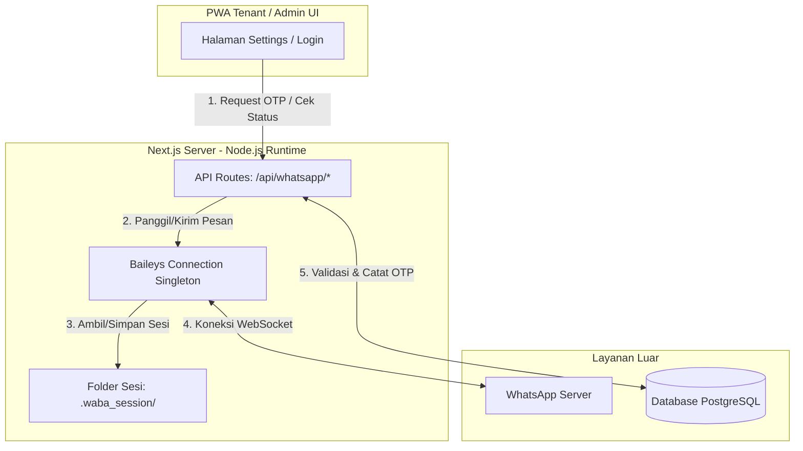
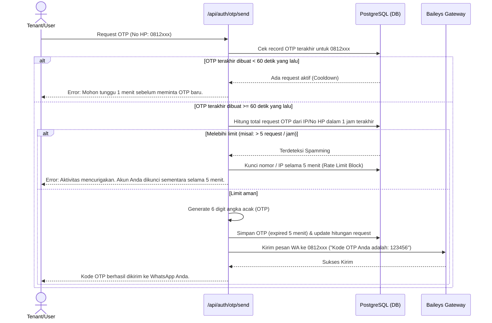

# Rencana Implementasi: WhatsApp OTP Gateway (Baileys)

Rencana ini menjelaskan rancangan integrasi **WhatsApp OTP** menggunakan library **Baileys** yang digabungkan langsung di dalam proyek **Next.js (Opsi B)**. Fokus utama dari rencana ini adalah mendukung verifikasi ganti/reset password yang aman, andal, dan ramah pengguna (*user-friendly*), serta dilengkapi dengan pengaman dari tindakan penyalahgunaan (*spamming/rate-limiting*).

---

## 1. Arsitektur Integrasi Baileys (Opsi B)

Karena saat ini database dan backend berjalan menggunakan Supabase + Next.js Server Actions & Routes di dalam satu repositori, kita akan mengintegrasikan Baileys langsung di dalam Next.js server. 

> [!NOTE]
> Opsi B ini mengasumsikan aplikasi dideploy pada lingkungan VPS (Virtual Private Server) menggunakan PM2 atau `node server.js` sehingga proses Node.js dapat berjalan secara persisten (*long-lived process*).



### Komponen Utama:
1. **WhatsApp Connection Singleton (`src/lib/whatsapp.ts`):** 
   Mempertahankan satu instans WebSocket Baileys yang aktif selama server Next.js berjalan.
2. **Session Storage (`.waba_session/`):**
   Folder lokal (ditambahkan ke `.gitignore`) untuk menyimpan data autentikasi WA Web (kredensial, kunci enkripsi) agar sesi tetap terjaga saat server direstart.
3. **WhatsApp Admin Panel (Route `/admin/settings/whatsapp`):**
   Halaman khusus bagi Admin/Pemilik Kost untuk melihat status koneksi WA (Connected/Disconnected) dan menampilkan QR Code untuk dipindai jika sesi terputus.

---

## 2. Mekanisme Proteksi & Rate Limiting OTP

Untuk melindungi nomor WhatsApp Gateway agar tidak diblokir oleh pihak WhatsApp akibat pengiriman pesan beruntun (*spamming*), kita menerapkan sistem proteksi ganda:

### A. Proteksi Sisi Klien (Frontend - PWA Tenant / Admin UI)
1. **Status Loading & Unclickable Button:**
   Saat tombol *"Kirim OTP"* ditekan, tombol langsung masuk ke status `loading` (dinonaktifkan) untuk mencegah klik ganda (*double-click*).
2. **Countdown Timer (Cooldown 60 Detik):**
   Setelah OTP berhasil dikirim, tombol akan dinonaktifkan selama **60 detik** dengan hitung mundur visual (misal: `"Kirim Ulang (59s)"`).

### B. Proteksi Sisi Server (Backend - API & Database Rate Limiter)
Sistem membatasi pengiriman OTP berdasarkan nomor telepon target (`phoneNumber`) dan alamat IP pengirim untuk mencegah eksploitasi terprogram.



---

## 3. Detail Alur 3 Skenario Reset & Ganti Password

### Skenario 1: Lupa Password — Belum Login (Halaman Login PWA)
Digunakan ketika tenant benar-benar tidak bisa mengakses aplikasi.

1. Pengguna membuka `/login` dan memilih menu **"Lupa Password"**.
2. Pengguna memasukkan nomor WhatsApp terdaftar.
3. Sistem memverifikasi apakah nomor tersebut terdaftar di database.
4. Jika terdaftar, sistem mengirimkan kode OTP via WhatsApp (menerapkan aturan *Rate Limiting*).
5. Pengguna memasukkan kode OTP di halaman verifikasi.
6. Jika OTP valid, pengguna diarahkan ke form **"Atur Password Baru"**.
7. Setelah password baru disimpan, sesi OTP dihapus dari database, dan pengguna dapat login dengan password barunya.

---

### Skenario 2: Ganti Password — Sudah Login (Menu Settings / Profile PWA)
Digunakan ketika tenant masih login (berkat cache/sesi PWA), tetapi dia lupa password barunya yang telah diganti dari password default (`oskost123`).

1. Pengguna masuk ke halaman **Settings / Profile**.
2. Pengguna membuka form **"Ubah Password"**.
3. Di dalam form tersebut, terdapat inputan:
   * *Password Lama*
   * *Password Baru*
   * *Konfirmasi Password Baru*
4. Di samping input *Password Lama*, terdapat tombol **"Lupa password lama?"**.
5. Ketika tombol tersebut diklik:
   * Sistem mengirimkan kode OTP ke nomor WhatsApp yang terdaftar pada profil pengguna tersebut.
   * Input *Password Lama* akan disembunyikan/dinonaktifkan, lalu digantikan oleh kolom input **Kode OTP**.
6. Pengguna memasukkan kode OTP dan Password Baru yang diinginkan.
7. Sistem memverifikasi OTP; jika valid, password baru langsung disimpan tanpa memvalidasi *Password Lama*.

---

### Skenario 3: Manual Recovery (Reset via Pemilik Kost / Admin)
Digunakan sebagai jalur alternatif terakhir jika tenant kehilangan nomor WhatsApp-nya atau tidak dapat menerima OTP karena kendala teknis.

1. Tenant menemui Pemilik Kost / Admin secara fisik untuk melapor.
2. Admin membuka Dashboard Admin pada menu **Detail Tenant**.
3. Admin menekan tombol **"Reset Password Tenant"**.
4. Sistem memproses permintaan:
   * Membuat string acak aman sepanjang 8 karakter sebagai password sementara (misal: `oskost-7F3A29`).
   * Meng-hash password sementara tersebut dan menyimpannya ke database untuk kolom `passwordHash` user.
   * Mengubah status user pada field `forcePasswordReset` menjadi `true` di database.
5. Sistem menampilkan pop-up dialog di layar admin:
   > **Password Sementara Berhasil Dibuat!**
   > Silakan berikan password sementara ini kepada Tenant: **`oskost-7F3A29`**
   > *Catatan: Tenant akan diminta langsung membuat password baru saat login menggunakan password ini.*
6. Tenant melakukan login pada perangkatnya menggunakan nomor HP dan password sementara tersebut.
7. Sistem mendeteksi `forcePasswordReset === true`, sehingga setelah login sukses, tenant **tidak langsung masuk ke dashboard**, melainkan dipaksa masuk ke halaman **"Ubah Password Wajib"** untuk mengganti password sementara ke password pribadinya yang baru.
8. Setelah tenant menyimpan password baru, nilai `forcePasswordReset` diubah kembali menjadi `false`, dan tenant dapat menggunakan PWA secara normal.

---

## 4. Rencana Perubahan Database (Prisma Schema)

Untuk mendukung rencana di atas, berikut adalah perubahan yang akan dilakukan pada berkas `prisma/schema.prisma`:

```prisma
// 1. Tambahkan field baru di model User
model User {
  id                 String   @id @default(cuid())
  email              String?  @unique
  phoneNumber        String?  @unique
  passwordHash       String
  role               UserRole @default(TENANT)
  
  // Menandai jika password direset oleh admin dan wajib diganti saat login pertama kali
  forcePasswordReset Boolean  @default(false) 
  
  createdAt          DateTime @default(now())
  updatedAt          DateTime @updatedAt
  
  // Relasi lainnya...
}

// 2. Buat model baru untuk mencatat verifikasi OTP
model OtpVerification {
  id          String   @id @default(cuid())
  phoneNumber String   // Nomor tujuan pengiriman OTP
  codeHash    String   // Hash dari kode OTP (untuk keamanan)
  attempts    Int      @default(0) // Melacak jumlah salah input (maksimal 3 kali)
  expiresAt   DateTime // Waktu kedaluwarsa OTP (5 menit dari pembuatan)
  createdAt   DateTime @default(now())
  
  // Menyimpan waktu request terakhir untuk rate limit per nomor
  lastRequestedAt DateTime @default(now()) @updatedAt

  @@index([phoneNumber])
}
```

---

## 5. Masukan Tambahan & Rekomendasi Keamanan

1. **Gunakan Enkripsi untuk OTP di Database:**
   Jangan menyimpan kode OTP (misal `123456`) dalam bentuk *plain text* di database. Gunakan *hashing* sederhana (seperti `SHA-256` atau `bcrypt` ringan) demi keamanan data jika database bocor.
2. **Interval Delay Pengiriman Pesan (*Anti-Spam* Baileys):**
   Saat mengirim pesan menggunakan Baileys, pastikan untuk menambahkan delay buatan acak antara 1–3 detik sebelum mengirim pesan ke server WhatsApp. Hal ini meminimalisir deteksi spam dari algoritma WhatsApp.
3. **Autentikasi Ulang Multi-Faktor (MFA) untuk Admin:**
   Karena Admin dapat melakukan reset password untuk Tenant mana pun tanpa verifikasi OTP fisik, tombol **"Reset Password"** di panel admin harus dilindungi dengan konfirmasi password Admin itu sendiri sebelum password sementara tenant ditampilkan.
4. **Pemisahan Sesi Disk:**
   Karena file sesi WhatsApp (`.waba_session/`) sangat sensitif (siapa saja yang memiliki folder ini bisa membajak WhatsApp Anda), folder ini harus dilindungi dengan izin baca/tulis terbatas pada sistem operasi server (VPS) dan pastikan **TIDAK PERNAH** ter-commit ke GitHub.

---

## 6. Rencana Langkah Kerja (Milestones)

- [ ] **Langkah 1:** Tambahkan pustaka `@whiskeysockets/baileys` beserta dependensinya (`qrcode-terminal`, `pino`, dsb) ke proyek.
- [ ] **Langkah 2:** Perbarui berkas `prisma/schema.prisma` dengan model `OtpVerification` dan field `forcePasswordReset` pada model `User`, lalu jalankan migrasi database.
- [ ] **Langkah 3:** Implementasikan koneksi Baileys Singleton di sisi server Next.js dan buat halaman scan QR Code di Dashboard Admin.
- [ ] **Langkah 4:** Buat API Route `/api/auth/otp/send` dan `/api/auth/otp/verify` yang menerapkan validasi rate limiting & enkripsi kode OTP.
- [ ] **Langkah 5:** Implementasikan frontend UI di PWA Tenant:
  * Fitur Lupa Password (Belum Login) lengkap dengan countdown timer.
  * Opsi "Lupa password lama?" menggunakan verifikasi OTP di halaman Settings.
- [ ] **Langkah 6:** Implementasikan fitur Admin Reset Tenant di Dashboard Admin (termasuk modul pembuatan password sementara dan logika paksa ganti password saat login).
