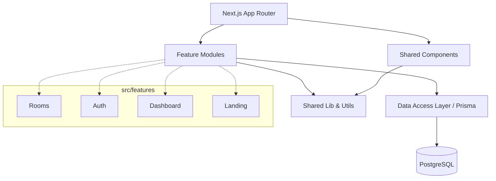

# Project Architecture Blueprint

## 1. Architecture Detection and Analysis

**Detected Technology Stack:**

- **Framework**: Next.js 16.1.6 (App Router)
- **UI Library**: React 19.2.3, Radix UI
- **Styling**: Tailwind CSS v4, Framer Motion
- **Database & ORM**: PostgreSQL, Prisma v7.3.0
- **Authentication**: NextAuth.js v5 (beta), Supabase
- **State Management**: Jotai
- **Utilities**: Zod (Validation), Nuqs (Search Params), Server-only, Next/Cache (unstable_cache)

**Architectural Pattern:**

- **Feature-Sliced Design (FSD) / Feature-Driven Architecture** integrated with the **Next.js Layered Architecture**.
- **Server Components & Server Actions**: Leveraging Next.js App Router for server-side rendering, data fetching, and mutations.
- **Component-Based UI**: Atomic design principles with reusable `src/components` and feature-specific components in `src/features`.

## 2. Architectural Overview

The application follows a modular, feature-based architecture combined with Next.js App Router paradigms.

- **Feature Encapsulation**: Domain-specific logic is isolated into feature modules (e.g., `src/features/rooms`, `src/features/auth`). Each feature contains its own UI components, server functions, and hooks.
- **Strict Layer Separation**: Shared utilities, global UI components, and domain features are separated. The `src/app` layer acts as the routing orchestrator, stitching features together into pages.
- **Data Fetching via Server Components**: Features expose service files (e.g., `room-service.ts`) enforcing `server-only` boundaries.
- **Granular Caching**: Utilization of `unstable_cache` with tag-based invalidation (`revalidateTag`) for high-performance data access.
- **Strict Client-Side Boundary**: Push `"use client"` to the absolute leaf nodes (interactivity-only) to minimize client bundle size and maximize server-rendering efficiency.
- **Advanced SEO Foundation**: Systematic use of Metadata API, Viewport API, JSON-LD structured data, and programmatically generated `robots.ts`/`sitemap.ts`.

## 3. Architecture Visualization

### High-Level Subsystem Organization



### Dependency Flow

1. **Routing Layer (`src/app`)** depends on Features, Components, and Layouts.
2. **Features (`src/features`)** depend on Data Access (Prisma), Shared Libs, and sometimes Shared Components.
3. **Data Access (`src/lib/db.ts`)** communicates with PostgreSQL.
4. **Direction Rule**: Features cannot depend on the Routing layer. Shared components cannot depend on Features.

## 4. Core Architectural Components

### Feature Modules (e.g., `src/features/rooms`)

- **Purpose**: Encapsulate a complete vertical slice of a business domain (e.g., Room browsing, booking).
- **Internal Structure**:
  - `components/`: UI specific to this feature.
  - `room-service.ts`: Server-only data access methods with Zod validation and `unstable_cache`.
  - `<feature>-view.tsx`: Main server component view that orchestrates feature layout and injects static data into client leaf components.
- **Interaction Patterns**: Exposes Typescript types, Zod schemas, and server-side functions. Push interactivity to specialized client components within the `components/` subfolder.

### Shared UI Components (`src/components`)

- **Purpose**: Generic, domain-agnostic UI elements.
- **Internal Structure**: Usually categorized into `ui/` for base Radix/Tailwind components and `layout/` for structural components.
- **Interaction**: Consumed by both `src/app` and `src/features`.

### Shared Utilities (`src/lib`)

- **Purpose**: Singleton instances and pure functions.
- **Internal Structure**: `db.ts` (Prisma Client), `utils.ts` (Tailwind merge utils), `supabase/` (Supabase client wrappers).

## 5. Architectural Layers and Dependencies

1. **Routing (`src/app`)**: Route definitions, Layouts, Server Components for data fetching.
2. **Feature Slices (`src/features/*`)**: Domain logic and feature-specific components.
3. **Core Services (`src/lib`)**: Database instantiation, Auth config.
4. **Data Models (`prisma/schema.prisma`)**: Source of truth for database schema and types.

**Enforced Boundaries**:

- `server-only` package in services.
- Zod validation at service entry points.
- `unstable_cache` for database query results.
- `loading.tsx` and `error.tsx` files per route group for consistent streaming/error handling.

## 6. Data Architecture

- **Domain Models (Prisma)**:
  - **Core Entities**: `Property`, `Room`, `User`, `TenantProfile`, `Lease`, `Invoice`, `Report`.
  - **Relationships**: A `Property` has many `Room`s. `User`s have a `TenantProfile` and multiple `Lease`s. A `Lease` links a `User` to a `Room` and generates `Invoice`s and `Report`s.
- **Data Access Patterns**: Service methods in `src/features/*/*-service.ts` abstract Prisma calls, providing strongly typed returns.
- **Caching Layer**: Queries are wrapped in `unstable_cache` with specific tags (e.g., `rooms-landing`, `room-{id}`) to enable precise invalidation via `revalidateTag`.
- **Validation**: Zod handles input validation at the service level (for query params) and the server action level (for form submissions).

## 7. Cross-Cutting Concerns Implementation

- **Authentication & Authorization**: Handled via `NextAuth.js v5` (`src/auth.ts`, `src/auth.config.ts`) and Supabase. Role-based access (ADMIN vs. TENANT) is defined in the Prisma schema and enforced in middleware or server actions.
- **Validation**: Schema-based validation using Zod for all entry points: services, server actions, and API-like functions.
- **Error Handling**:
  - React Error Boundaries (`src/app/error.tsx`) catch rendering/server errors.
  - `not-found.tsx` (Server Component) handles resource-not-found states.
  - Form/Mutation errors are returned as strings or structured objects from Server Actions.
- **Streaming & Loading**: System-wide use of `loading.tsx` files for skeleton-based progressive loading.
- **Styling**: Handled by Tailwind CSS v4 and `class-variance-authority` for strongly-typed variant generation.

## 8. Service Communication Patterns

- **Internal Communication**: Synchronous function calls between App Router Server Components and Feature Services (e.g., `await getRoomsForLanding()`).
- **Client-to-Server**: Next.js Server Actions or Server-rendered props passed down to Client Components.
- **Database**: Prisma Client abstracts connection pooling and SQL queries over TCP/pg driver.

## 9. Technology-Specific Architectural Patterns

#### React / Next.js Architectural Patterns

- **Server Components First**: By default, components are Server Components. `"use client"` is added strictly at the leaves of the render tree (for interactivity or hooks like Jotai).
- **Colocation**: Files are colocated by domain in `src/features/` rather than separating all components, hooks, and services by technical type.
- **Route Groups**: Folders like `(dashboard)` and `(marketing)` manage layout boundaries and common loading/error states without affecting URL paths.
- **Performance Optimization**:
  - `next/image`: Systematic use of `sizes`, `priority` for LCP, and remote patterns for Supabase.
  - `next/font`: Preloaded fonts via CSS variables to eliminate CLS.
  - JSON-LD: Structured data injected via Server Components for rich search results.

## 10. Implementation Patterns

```typescript
import "server-only";
import { prisma } from "@/lib/db";
import { unstable_cache } from "next/cache";
import { z } from "zod";

const idSchema = z.string().cuid();

export const getEntityById = (id: string) =>
  unstable_cache(
    async (entityId: string) => {
      const parsed = idSchema.parse(entityId);
      return await prisma.entity.findUnique({ where: { id: parsed } });
    },
    [`entity-${id}`],
    { tags: [`entity-${id}`], revalidate: 3600 },
  )(id);
```

_Combines validation, caching, and server-only enforcement._

- **UI Component Pattern**:
  Using `class-variance-authority` (cva), `clsx`, and `tailwind-merge` for predictable, conflict-free styling.

## 11. Extension and Evolution Patterns

- **Adding a New Feature**:
  1. Create a new directory under `src/features/[feature-name]`.
  2. Implement data access in `[feature-name]-service.ts`.
  3. Create specific UI blocks in `src/features/[feature-name]/components`.
  4. Aggregate them in an `index.ts` to export public members.
  5. Consume the feature in `src/app`.
- **Modifying the Schema**:
  Update `prisma/schema.prisma`, run `npx prisma migrate dev`, and update the corresponding feature services.

## 12. Architecture Governance

- **Linter**: ESLint config enforces codebase standards.
- **TypeScript**: Strict type checking prevents regression when data models change. Prisma auto-generates client types on schema change.
- **Security**: `server-only` package prevents accidental leakage of server secrets to the client bundle.

## 13. Blueprint for New Development

### Development Workflow for a New Domain Feature

1. **Model Definition**: If data is required, define models in `prisma/schema.prisma` first.
2. **Feature Initialization**:
   - Create `src/features/my-domain` folder.
   - Create `src/features/my-domain/service.ts` for Prisma queries.
3. **UI Development**:
   - Build client/server components in `src/features/my-domain/components`.
4. **Integration**:
   - Create a page route in `src/app/(group)/my-route/page.tsx`.
   - Call the service from the page Server Component and pass the data to the feature's UI components.

### Common Pitfalls

- **Accidental Client-Side Data Leaks**: Avoid passing entire database objects with sensitive data (like `passwordHash`) down to Client Components. Use `select` in Prisma to retrieve only necessary fields.
- **Unnecessary "use client"**: Default to Server Components. Only use "use client" for components requiring `useState`, `useEffect`, `onClick` handlers, or Jotai state.
- **Cross-Feature Imports**: Try to avoid circular dependencies between features. If two features need the same logic, promote it to `src/components`, `src/hooks`, or `src/lib`.

## 14. Database supabase configuration for picture

1. **Bucket** : name => Oskost-Data-Private and name => Oskost-Data-Public, for S3 Configuration Endpoint => https://wmepodmqusjhlvungyzc.storage.supabase.co/storage/v1/s3
2. **Storage DB** : our database

## 15. Implementation 360° image with Photo Sphere Viewer A JavaScript library to display 360° panoramas

1. **Install Photo Sphere Viewer** : pnpm install @photo-sphere-viewer/core
2. **react-photo-sphere-viewer** : pnpm install @photo-sphere-viewer/core react-photo-sphere-viewer
3. **Format storage at database** : Storage is done using a combination of two services from Supabase: Image File (Image Blob): Raw files in their original format (JPG or PNG) uploaded by the user will be directly sent and stored to Supabase Storage. The maximum file size is limited to 10MB in this application. Metadata (Database): After being successfully saved in Storage, Supabase will return the image download URL. The image URL along with other information in object/JSON format will be stored into the Supabase Database (NoSQL database) namely with PostgreSQL.
4. **Component** : make a upload component in case can drag and drop folder, and don't forget for validation every condition that file picture from type,size,available or not to Panorama Equirectangular image,
5. **Base rule** : this is for base rule implementation and for every thing about Stategic "Lazy Load" and anything use our rule in this architecture
6. **example Implementation** :
   "
   // # app/page.js
   "use client"

import React from "react";
import { ReactPhotoSphereViewer } from "react-photo-sphere-viewer";

// Import plugins
import { MarkersPlugin } from '@photo-sphere-viewer/markers-plugin';
import { CompassPlugin } from '@photo-sphere-viewer/compass-plugin';

// Import plugins stylesheets
import '@photo-sphere-viewer/markers-plugin/index.css';
import '@photo-sphere-viewer/compass-plugin/index.css';

export default function Home() {
const imgSrc = 'https://photo-sphere-viewer-data.netlify.app/assets/sphere.jpg'
const plugins = [
[MarkersPlugin,
{
markers: [
{
id: "image",
position: { yaw: "0.33deg", pitch: "0.1deg" },
image: "vercel.svg",
anchor: "bottom center",
size: { width: 128, height: 128 },
tooltip: "Marker Tooltip Test",
},
],
},],
[CompassPlugin, {
hotspots: [
{ yaw: '0deg' },
{ yaw: '90deg' },
{ yaw: '180deg' },
{ yaw: '270deg' },
],
}]
]

return (

<div>
<ReactPhotoSphereViewer
src={imgSrc}
height={"100vh"}
width={"100%"}
plugins={plugins} ></ReactPhotoSphereViewer>
</div>
);
}
"

---

_Updated: 2026-05-01 (Refactor v2: SEO, Performance, Caching & Layered Architecture)_
